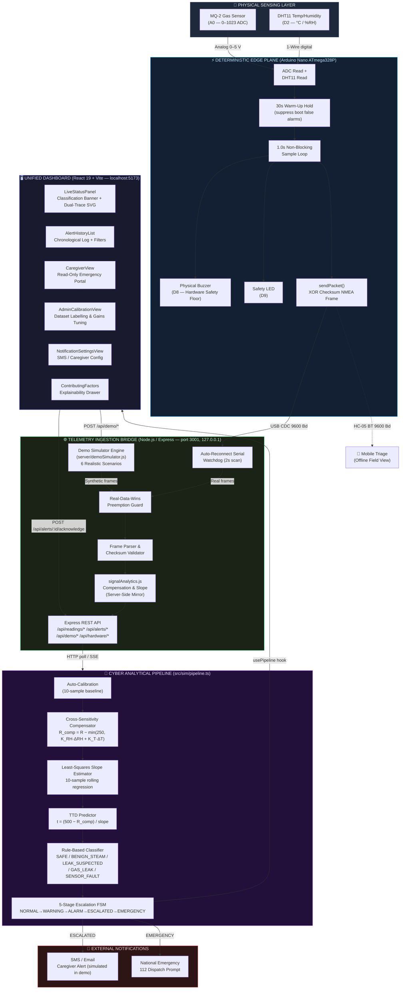

# 5.1 System Architecture Diagram

## SENTINEL: Dual-Tier Cyber-Physical Architecture

## Architectural Tiers Summary

| Tier | Technology | Location | Key Responsibility |
| :--- | :--- | :--- | :--- |
| **Physical Sensing** | MQ-2 Gas + DHT11 Temp/RH | Arduino `A0`, `D2` | Raw environmental data acquisition |
| **Deterministic Edge** | Arduino Nano ATmega328P | Embedded (standalone) | Autonomous 1.0s safety floor, XOR-framed telemetry TX |
| **Ingestion Bridge** | Node.js + Express + SerialPort | `127.0.0.1:3001` | Serial watchdog, frame parsing, REST API, demo simulator |
| **Analytical Pipeline** | TypeScript (pure functional) | `src/sim/pipeline.ts` | Compensation, slope, TTD, classification, FSM escalation |
| **Unified Dashboard** | React 19, Vite, Tailwind CSS | `localhost:5173` | Real-time monitoring, caregiver portal, calibration |
| **External Dispatch** | SMS / 112 (simulated in demo) | External | Caregiver notification and emergency services escalation |
