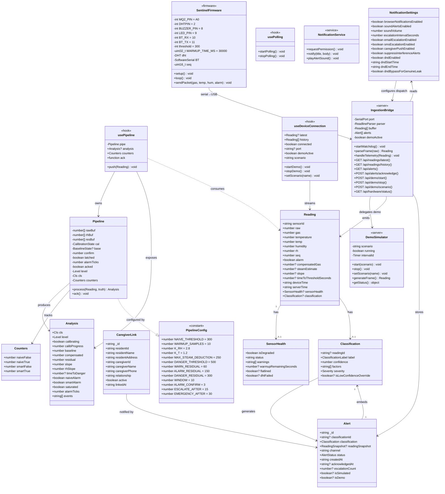

# 5.3 Class Diagram

## SENTINEL: Key Classes, Interfaces & Relationships

## Type Aliases

| Alias | Values |
| :--- | :--- |
| `Cls` | `"CALIBRATING"` \| `"SAFE"` \| `"BENIGN_STEAM"` \| `"LEAK_SUSPECTED"` \| `"GAS_LEAK"` \| `"SENSOR_FAULT"` |
| `Level` | `"NORMAL"` \| `"WARNING"` \| `"ALARM"` \| `"ESCALATED"` \| `"EMERGENCY"` \| `"ACKNOWLEDGED"` |
| `ClassificationLabel` | `"Normal"` \| `"Background Interference"` \| `"Genuine Leak"` |
| `Severity` | `"low"` \| `"medium"` \| `"high"` |
| `AlertStatus` | `"active"` \| `"acknowledged"` \| `"suppressed"` |
