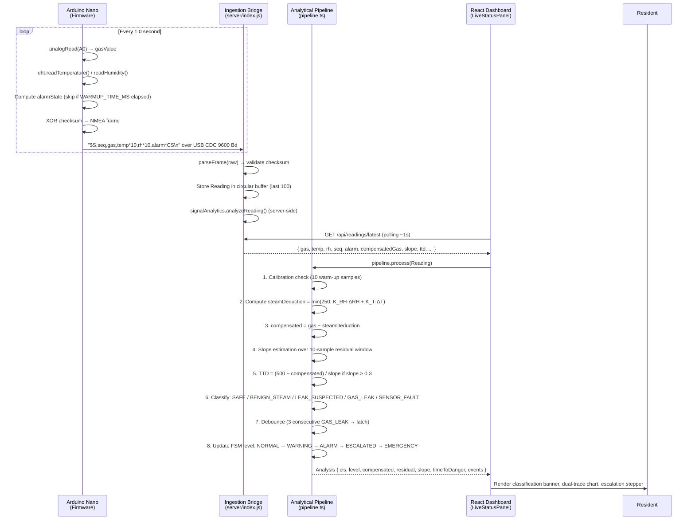
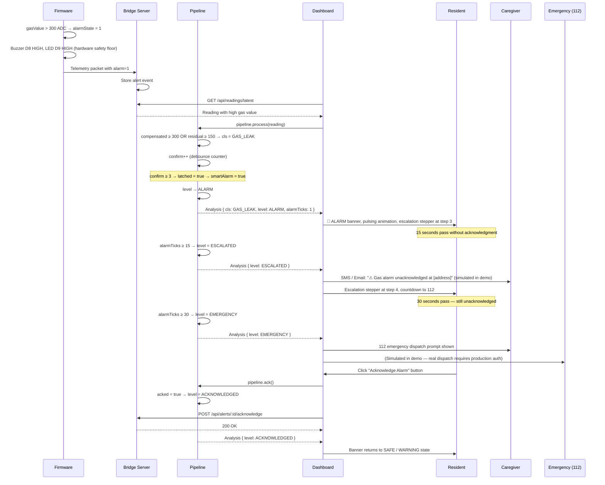

# 5.4 Sequence & Activity Diagrams

## 5.4.1 — Normal Telemetry Ingestion Sequence



---

## 5.4.2 — Gas Leak Detection & Escalation Sequence



---

## 5.4.3 — Demo Simulator Activation Activity Diagram

```mermaid
flowchart TD
    START([Resident Clicks 'Demo Readings' Toggle]) --> CHECK_HW{Is real Arduino\nhardware connected?}
    CHECK_HW -->|Yes| BLOCK[Show hardware lock warning\nDemo blocked — real device active]
    CHECK_HW -->|No| SEL[Show Scenario Selector\nnormal / steam / cooking / gas_leak\nadc_saturation / sensor_fault]
    SEL --> SETSCEN[POST /api/demo/scenario]
    SETSCEN --> START_DEMO[POST /api/demo/start]
    START_DEMO --> GEN["DemoSimulator.generateFrame()\nat 1 Hz interval"]
    GEN --> INJECT[Inject synthetic Reading\ninto Bridge telemetry buffer]
    INJECT --> LABEL[Tag frame: isDemo = true]
    LABEL --> UI_RECV[Dashboard polls GET /api/readings/latest]
    UI_RECV --> PIPE_PROC[Pipeline.process() — normal analysis]
    PIPE_PROC --> RENDER[Render live chart & classification]
    RENDER --> CHECK_REAL{Real device\npacket received?}
    CHECK_REAL -->|Yes| PREEMPT[PREEMPT: stop demo immediately\nDisplay 'Real device detected' toast]
    CHECK_REAL -->|No| CHECK_STOP{User clicks\nStop Demo?}
    CHECK_STOP -->|No| GEN
    CHECK_STOP -->|Yes| STOP[POST /api/demo/stop]
    STOP --> CLEAR[Clear telemetry buffer\nReset UI toggle]
    CLEAR --> END([End])
    PREEMPT --> END
    BLOCK --> END
```

---

## 5.4.4 — Pipeline Compensation Activity Diagram

```mermaid
flowchart TD
    A([Raw Reading Received\ngasValue, temp, rh]) --> B{Sensor Fault?\nrh < 0 OR temp < −40?}
    B -->|Yes| FAULT["cls = SENSOR_FAULT\ncomp = raw (bypass)"]
    FAULT --> WARNLEVEL[level = WARNING]

    B -->|No| C{ADC Saturated?\ngas >= 1023}
    C -->|Yes| D["cls = GAS_LEAK\nsaturated = true\ncomp = 1023"]
    C -->|No| E{Calibration\nComplete?\n≥ 10 samples?}

    E -->|No| F[Push to calibration buffer\ncal.g, cal.h, cal.t\nReturn CALIBRATING state]
    E -->|Yes| G[Compute environmental deltas\nΔRH = max(0, rh − RH₀)\nΔT = max(0, temp − T₀)]

    G --> H["steamDeduction = min(250,\nmax(0, 2.8·ΔRH + 1.2·ΔT))"]
    H --> I["compensated = max(0,\ngas − steamDeduction)"]
    I --> J[residual = compensated − baseline_gas]
    J --> K[Append to 10-sample residual buffer]
    K --> L["slope m = Least-Squares(resBuf)"]
    L --> M{slope > 0.3\nAND comp < 500?}
    M -->|Yes| N["TTD = (500 − comp) / slope\ncapped at 600s"]
    M -->|No| O[TTD = null]

    N & O --> P{Classification\nDecision}
    P -->|"comp ≥ 500 OR residual ≥ 150"| Q["GAS_LEAK"]
    P -->|residual ≥ 60| R["LEAK_SUSPECTED"]
    P -->|naiveAlarm OR ΔRH > 5| S["BENIGN_STEAM\n(false alarm suppressed)"]
    P -->|otherwise| T["SAFE"]

    Q & R & S & T --> U{Debounce\nconfirm ≥ 3 consecutive\nGAS_LEAK?}
    U -->|Yes| LATCH["latched = true\nsmartAlarm = true"]
    U -->|No| UNLATCH{Previously latched\nAND residual < 30?}
    UNLATCH -->|Yes| RESET["latched = false\nsmartAlarm = false"]
    UNLATCH -->|No| KEEP[Keep current latch state]

    LATCH & RESET & KEEP --> FSM[Update Escalation FSM]
    FSM --> RET([Return Analysis Object])
    FAULT & D --> FSM
    WARNLEVEL --> FSM
```
