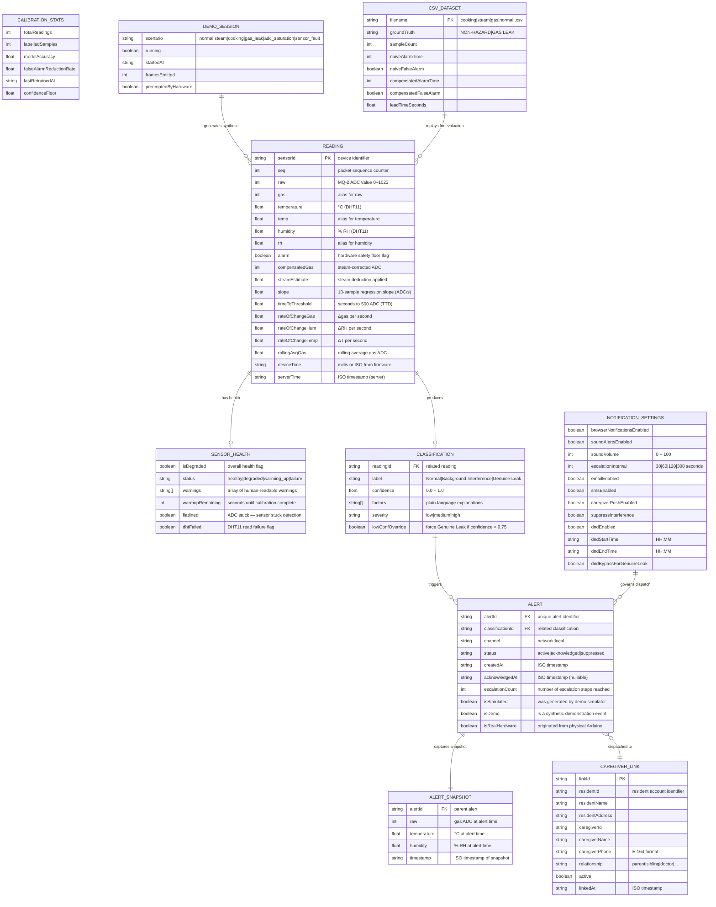
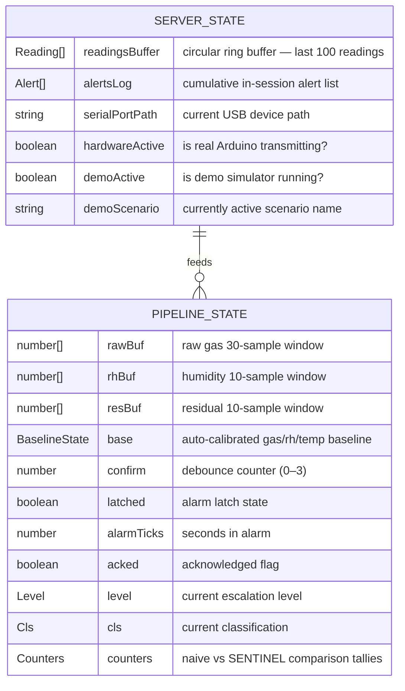

# 5.5 ER Diagram / Data Design

## SENTINEL: Entity-Relationship & In-Memory Data Schema

> **Note**: SENTINEL is a stateless prototype with **no persistent database**. All data lives in in-process server memory (circular buffers and arrays in `server/index.js`), TypeScript state in React hooks, and CSV flat files for empirical evaluation datasets. The schema below documents these runtime data structures as a logical ER model.

---

## 5.5.1 — Entity-Relationship Diagram

---

## 5.5.2 — In-Memory Server State (server/index.js)

---

## 5.5.3 — Empirical Dataset CSV Schema

Each file in `data/*.csv` represents one labeled sensor session recorded at 1.0 Hz.

| Column | Type | Description |
| :--- | :--- | :--- |
| `timestamp` | ISO / number | Sample timestamp |
| `gas` | integer (0–1023) | Raw MQ-2 ADC value |
| `temp` | float (°C) | DHT11 temperature reading |
| `rh` | float (%) | DHT11 relative humidity reading |
| `alarm` | 0 \| 1 | Hardware safety floor flag |
| `groundTruth` | `benign` \| `hazard` | Manually labeled class for evaluation |

| Dataset | File | Ground Truth | Samples | Key Characteristic |
| :--- | :--- | :--- | :--- | :--- |
| Normal Living | `data/normal.csv` | `benign` | 31 | 24°C, 50% RH, gas ~190 ADC baseline |
| Kitchen Steam | `data/steam.csv` | `benign` | 31 | RH spikes 50→90.5%, gas false-peak at 390 ADC |
| Stovetop Cooking | `data/cooking.csv` | `benign` | 31 | RH up to 78.5%, temp up to 31°C, false alarm at 365 ADC |
| Gas Leak | `data/gas.csv` | `hazard` | 26 | Dry conditions, gas ramps 190→912 ADC |
