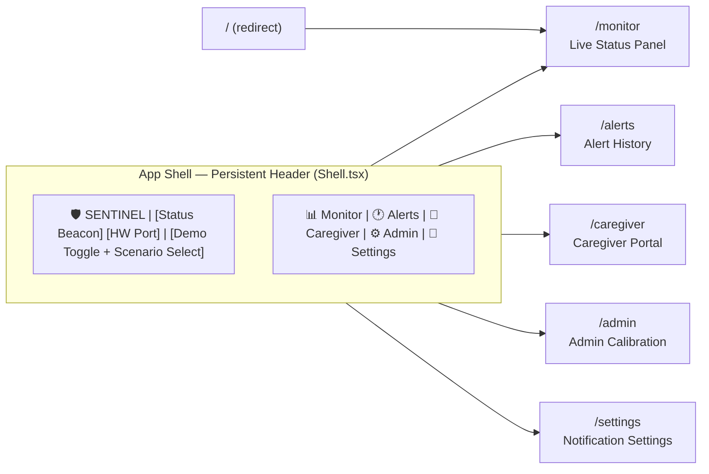
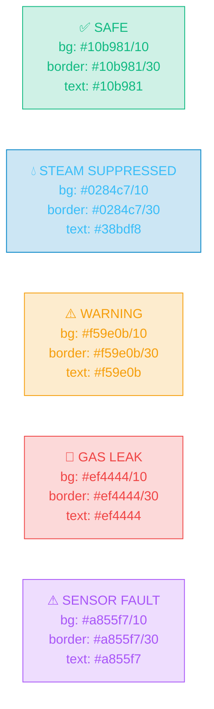

# 5.6 UI Design / Wireframes

## SENTINEL Dashboard — Screen Inventory & Navigation Structure

---

## 5.6.1 — Application Navigation Structure



---

## 5.6.2 — Screen 1: Live Monitor Dashboard (`/monitor`)

```
┌──────────────────────────────────────────────────────────────────────────────────────────────┐
│  🛡️ SENTINEL                         🟢 LIVE — /dev/cu.usbserial-1234   [Demo Readings ○ OFF]│
│  📊 Monitor  🕐 Alerts  💚 Caregiver  ⚙️ Admin  🔔 Settings                                  │
└──────────────────────────────────────────────────────────────────────────────────────────────┘
│                                                                                              │
│  ┌─────────────────────────────────────────────────────────────────────────────────────────┐ │
│  │                   ✅  SAFE — No Gas Detected                                          │ │
│  │              Environment Normal · Compensated Residual: +12 ADC                         │ │
│  └─────────────────────────────────────────────────────────────────────────────────────────┘ │
│                                                                                              │
│  ┌──────────────────┐  ┌──────────────────┐  ┌──────────────────┐  ┌──────────────────┐    │
│  │  🟢 Gas (Raw)    │  │  🟢 Compensated  │  │  🌡️ Temp         │  │  💧 Humidity     │    │
│  │     193 ADC      │  │     181 ADC      │  │    24.2 °C       │  │    51.0 %RH      │    │
│  └──────────────────┘  └──────────────────┘  └──────────────────┘  └──────────────────┘    │
│                                                                                              │
│  ┌──────────────────────────────────────────────────────────────────────────────────────┐   │
│  │  📈  Real-Time Gas Trace (last 60 seconds)                                          │   │
│  │                                                                                      │   │
│  │  500 ─ ─ ─ ─ ─ ─ ─ ─ ─ ─ ─ ─ ─ ─ ─ ─ ─ ─ ─ DANGER FLOOR                         │   │
│  │  300 ─ ─ ─ ─ ─ ─ ─ ─ ─ ─ ─ ─ ─ ─ ─ ─ ─ ─ ─ ALARM THRESHOLD                      │   │
│  │  190 ──────────────────────────  (Raw ADC — slate line)                             │   │
│  │  178 ─ ─ ─ ─ ─ ─ ─ ─ ─ ─ ─ ─ ─ (Compensated — emerald dashed line)               │   │
│  │       └── 60s ────── 45s ────── 30s ────── 15s ────── now                          │   │
│  └──────────────────────────────────────────────────────────────────────────────────────┘   │
│                                                                                              │
│  ┌──────────────────────────────────────────────────────────────────────────────────────┐   │
│  │  🔒 Escalation State Machine                                                         │   │
│  │                                                                                      │   │
│  │  [✅ NORMAL] ──→ [⚠ WARNING] ──→ [🔴 ALARM] ──→ [📲 ESCALATED] ──→ [🚨 EMERGENCY]  │   │
│  │   ● Active        ○                ○               ○                  ○             │   │
│  └──────────────────────────────────────────────────────────────────────────────────────┘   │
│                                                                                              │
│  ┌──────────────────────┐  ┌──────────────────────┐  ┌──────────────────────────────────┐  │
│  │  📉 Slope            │  │  ⏱ Time to Danger    │  │  🧠 Contributing Factors [→]     │  │
│  │  +0.02 ADC/s         │  │  ∞ (safe)            │  │  ΔRH: +1.0%  ΔT: +0.2°C         │  │
│  │  (stable)            │  │                      │  │  Steam deduction: −12 ADC         │  │
│  └──────────────────────┘  └──────────────────────┘  └──────────────────────────────────┘  │
│                                                                                              │
│  ┌─────────────────────────────────────────────────────────────────────────────────────┐    │
│  │  ⚠️  This system supplements, not replaces, certified gas-safety practice.          │    │
│  └─────────────────────────────────────────────────────────────────────────────────────┘    │
└──────────────────────────────────────────────────────────────────────────────────────────────┘
```

### ALARM STATE Variant — Monitor Panel

```
┌─────────────────────────────────────────────────────────────────────────────────────────────┐
│  ┌──────────────────────────────────────────────────────────────────────────────────────┐  │
│  │  🚨🚨  GAS LEAK DETECTED  🚨🚨                              [ACKNOWLEDGE ALARM]      │  │
│  │  Compensated Residual: +187 ADC · Slope: +3.8 ADC/s · TTD: 82 seconds              │  │
│  └──────────────────────────────────────────────────────────────────────────────────────┘  │
│                                                                                             │
│  ┌──────────────────────────────────────────────────────────────────────────────────────┐  │
│  │  🔒 Escalation State Machine                                                         │  │
│  │  [✅ NORMAL] ──→ [⚠ WARNING] ──→ [🔴 ALARM ●] ──→ [📲 ESCALATED] ──→ [🚨 EMERGENCY] │  │
│  │                                  ● Active  ── 12s elapsed ── SMS in: 3s             │  │
│  └──────────────────────────────────────────────────────────────────────────────────────┘  │
└─────────────────────────────────────────────────────────────────────────────────────────────┘
```

---

## 5.6.3 — Screen 2: Alert History (`/alerts`)

```
┌────────────────────────────────────────────────────────────────────────────────────────────┐
│  Shell Header (same as above)                                                              │
├────────────────────────────────────────────────────────────────────────────────────────────┤
│                                                                                            │
│  🕐 Alert History                     Filter: [All ▼]  [Status: All ▼]  [🔍 Search...]  │
│                                                                                            │
│  ┌──────────────────────────────────────────────────────────────────────────────────────┐ │
│  │  🔴  GAS LEAK           18:32:14  HIGH  active   [SIMULATED]  [View Factors →]       │ │
│  │  Gas: 412 ADC · Temp: 24.1°C · RH: 50.2%                                            │ │
│  │  Factors: Compensated residual +163 ADC; 3 consecutive GAS_LEAK classifications      │ │
│  ├──────────────────────────────────────────────────────────────────────────────────────┤ │
│  │  🟡  BACKGROUND INTERF. 18:28:09  MED   acknowledged [View Factors →]               │ │
│  │  Gas: 341 ADC · Temp: 28.3°C · RH: 78.5%                                            │ │
│  │  Factors: ΔRH +28.5%; steam deduction −86 ADC applied; residual +9 ADC only         │ │
│  ├──────────────────────────────────────────────────────────────────────────────────────┤ │
│  │  🟢  NORMAL             18:14:55  LOW   suppressed  [View Factors →]               │ │
│  └──────────────────────────────────────────────────────────────────────────────────────┘ │
│                                                                                            │
│  ── Contributing Factors Drawer (slide-in from right) ─────────────────────────────────── │
│  │  🧠 Why was this classified as "Genuine Leak"?                            [✕ Close] │  │
│  │  ─────────────────────────────────────────────────                                  │  │
│  │  📊 Gas Residual Above Threshold       +163 ADC (threshold: +150 ADC)              │  │
│  │  📈 Rising Slope Detected              +3.8 ADC/s over 10 samples                  │  │
│  │  ⏱  Time to Danger                    82 seconds to 500 ADC                        │  │
│  │  💧 Humidity (stable — not steam)      ΔRH +0.2% (below 5% steam threshold)        │  │
│  │  🌡️  Temperature (stable)              ΔT +0.1°C                                   │  │
│  │  💡 Steam deduction applied: 0.56 ADC (minimal — not a steam event)                │  │
│  └──────────────────────────────────────────────────────────────────────────────────────┘ │
└────────────────────────────────────────────────────────────────────────────────────────────┘
```

---

## 5.6.4 — Screen 3: Caregiver Portal (`/caregiver`)

```
┌─────────────────────────────────────────────────────────────────────────────────────────────┐
│  Shell Header                                                                               │
├─────────────────────────────────────────────────────────────────────────────────────────────┤
│                                                                                             │
│  💚 Remote Caregiver View          👤 Resident: Flat 3B, VIT Campus Road                  │
│                                                                                             │
│  ┌─────────────────────────────────────────────────────────────────────────────────────┐   │
│  │                        ✅  RESIDENT IS SAFE                                        │   │
│  │               Last update: 18:41:05  ·  Gas: 191 ADC  ·  Temp: 24.1°C            │   │
│  └─────────────────────────────────────────────────────────────────────────────────────┘   │
│                                                                                             │
│  ┌─────────────────────────────┐   ┌─────────────────────────────────────────────────────┐ │
│  │  🚨  Emergency Contact     │   │  🕐  Recent Alerts                                 │ │
│  │                             │   │  18:32 — GAS LEAK (acknowledged)                  │ │
│  │  [ 📞 CALL 112 NOW ]        │   │  18:28 — Steam / Background Interference           │ │
│  │  (disabled when safe)       │   │  17:55 — Normal                                   │ │
│  │                             │   │                              [View Full History →] │ │
│  └─────────────────────────────┘   └─────────────────────────────────────────────────────┘ │
│                                                                                             │
│  ⚠️  READ-ONLY VIEW — Caregivers cannot modify system settings or override alarms.         │
└─────────────────────────────────────────────────────────────────────────────────────────────┘
```

---

## 5.6.5 — Screen 4: Admin Calibration (`/admin`)

```
┌─────────────────────────────────────────────────────────────────────────────────────────────┐
│  Shell Header                                                                               │
├─────────────────────────────────────────────────────────────────────────────────────────────┤
│                                                                                             │
│  ⚙️ Admin Calibration & Model Retraining                                                   │
│                                                                                             │
│  ┌────────────────────────────────────────┐  ┌──────────────────────────────────────────┐  │
│  │  📊 Calibration Stats                 │  │  🔧 Compensation Gain Tuning             │  │
│  │  Total Readings:     14,280            │  │  K_RH (humidity gain):  [2.8 ▲▼]       │  │
│  │  Labelled Samples:    891              │  │  K_T  (temperature gain): [1.2 ▲▼]     │  │
│  │  FA Reduction:        100%             │  │  Danger Threshold:   [500 ADC ▲▼]      │  │
│  │  Alarm Threshold:     100%             │  │  Max Steam Deduction:[250 ADC ▲▼]      │  │
│  │  Last Retrained: 2026-10-19           │  │                    [ Save Config ]       │  │
│  └────────────────────────────────────────┘  └──────────────────────────────────────────┘  │
│                                                                                             │
│  ┌─────────────────────────────────────────────────────────────────────────────────────┐   │
│  │  📁 Historical Dataset Labelling                                                   │   │
│  │  Session    Samples  Label         Gas Range    Temp Range  RH Range               │   │
│  │  steam.csv    31     [Benign  ▼]  251–390 ADC  24.0–26.4°C 50–90.5%               │   │
│  │  cooking.csv  31     [Benign  ▼]  218–365 ADC  25.0–31.0°C 50–78.5%               │   │
│  │  gas.csv      26     [Hazard ▼]   190–912 ADC  24.0°C      50%                     │   │
│  │  normal.csv   31     [Benign  ▼]  185–195 ADC  24.0°C      50%                     │   │
│  │                                                    [ Run Benchmark Evaluation ]     │   │
│  └─────────────────────────────────────────────────────────────────────────────────────┘   │
└─────────────────────────────────────────────────────────────────────────────────────────────┘
```

---

## 5.6.6 — Screen 5: Notification Settings (`/settings`)

```
┌─────────────────────────────────────────────────────────────────────────────────────────────┐
│  Shell Header                                                                               │
├─────────────────────────────────────────────────────────────────────────────────────────────┤
│                                                                                             │
│  🔔 Notification & Alert Settings                                                          │
│                                                                                             │
│  ┌──────────────────────────────────────────────┐  ┌─────────────────────────────────────┐ │
│  │  🔊 Local Alerts                            │  │  📲 Caregiver Dispatch              │ │
│  │  Browser Notifications:  [ ON  ●      ]     │  │  SMS Escalation:  [ ON  ●      ]    │ │
│  │  Sound Alerts:           [ ON  ●      ]     │  │  Email Dispatch:  [ OFF      ● ]    │ │
│  │  Volume:                 [▓▓▓▓▓░░░] 70%    │  │  Caregiver Push:  [ ON  ●      ]    │ │
│  │                                              │  │  Phone: +91 9876543210 [Edit]       │ │
│  └──────────────────────────────────────────────┘  └─────────────────────────────────────┘ │
│                                                                                             │
│  ┌──────────────────────────────────────────────┐  ┌─────────────────────────────────────┐ │
│  │  ⏱  Escalation Timing                       │  │  🌙 Do Not Disturb                  │ │
│  │  SMS delay after alarm:  [ 15s  ▼ ]         │  │  DnD Mode:          [ OFF      ● ]  │ │
│  │  112 prompt delay:       [ 30s  ▼ ]         │  │  From: [22:00]  To: [07:00]         │ │
│  │  Suppress interference alerts: [ YES ● ]    │  │  Bypass for Genuine Leak: [✅ Always]│ │
│  └──────────────────────────────────────────────┘  └─────────────────────────────────────┘ │
│                                                                                             │
│                                               [ 💾 Save Settings ]  [ ↩ Reset Defaults ]  │
└─────────────────────────────────────────────────────────────────────────────────────────────┘
```

---

## 5.6.7 — Demo Simulator Panel (embedded in Shell header)

```
[ Demo Readings ●─────── ON ]   Scenario: [Gas Leak ▼]   [⏹ Stop]

  Ground Truth Table:
  ┌────────────────────────────────────────────────────────────────────────┐
  │ Scenario         Ground Truth    Plain Alarm   SENTINEL    Lead Time   │
  │ Normal           Non-Hazard      ✅ No FA       ✅ No FA   —           │
  │ Steam            Non-Hazard      🔴 FALSE ALARM ✅ Suppressed —        │
  │ Cooking          Non-Hazard      🔴 FALSE ALARM ✅ Suppressed —        │
  │ Gas Leak         Hazard          ✅ Detected    ✅ Detected +4.0s     │
  │ ADC Saturation   Hazard          ✅ Detected    ✅ Detected  0s       │
  │ Sensor Fault     —               —              ⚠ FAULT shown   —    │
  └────────────────────────────────────────────────────────────────────────┘
```

---

## 5.6.8 — Color Legend (Design Tokens)


