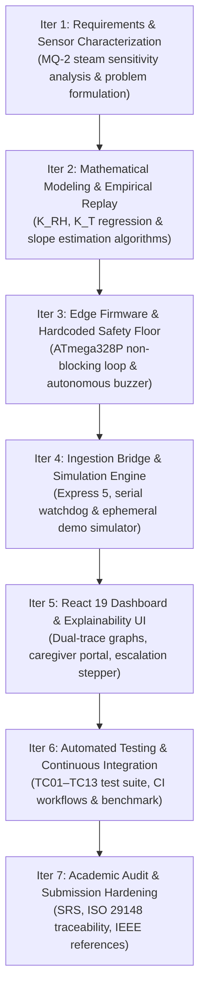
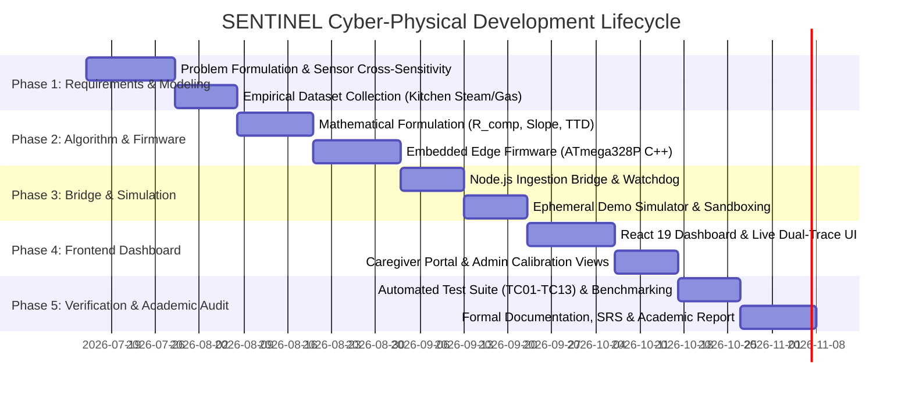

# Software Development Life Cycle (SDLC) Plan & Schedule
## SENTINEL: Dual-Tier Cyber-Physical Gas Leak Detection System

**Document**: `docs/report/SDLC_PLAN.md`  
**Version**: 1.0.0 (Final Submission)  
**Submitted by**: Shreedhar Sharma (Reg. No.: 24BPS1149)  
**Programme**: B.Tech — Computer Science and Engineering  
**Institution**: Vellore Institute of Technology (VIT) Chennai  
**Faculty Supervisor**: Dr Elakiya R  
**Academic Context**: Software Engineering Capstone Project Submission  

---

## 1. SDLC Process Model Selection & Justification

### Chosen Model: Iterative & Incremental Cyber-Physical Development Model

Developing cyber-physical systems (CPS) introduces tightly coupled dependencies between physical hardware transducers (MQ-2 analog behavior, DHT11 digital timing constraints), real-time serial protocols, mathematical regression algorithms, and modern asynchronous web dashboards. 

A traditional rigid Waterfall model is ill-suited for CPS because physical sensor cross-sensitivities and analog noise cannot be fully characterized purely in an upfront theoretical phase. Similarly, pure software-only Agile/Scrum sprints often neglect hardware lead times, electronic component thermal stabilization windows, and physical test safety hazards.

Consequently, SENTINEL adopted an **Iterative and Incremental Development Model** tailored for cyber-physical engineering, structured across seven distinct iterative cycles:



### Justification Criteria
1. **Empirical Calibration Loop**: The mathematical steam deduction model required empirical data collection in kitchen environments (`data/*.csv`) before finalizing regression constants ($K_{RH}=2.8, K_T=1.2$).
2. **Dual-Tier Hardware-Software Decoupling**: Implementing an edge safety floor on the microcontroller first ensured that subsequent software iterations on the web dashboard could never compromise physical life-safety.
3. **Hardware-Independent Verifiability**: Creating an ephemeral server-side simulator enabled rapid frontend and algorithmic iteration without requiring physical Arduino hardware at every desk, facilitating robust CI/CD automation.

---

## 2. Iterative Project Schedule & Milestone Timeline

The implementation and submission timeline is structured across a disciplined 14-week project lifecycle:



### Milestone & Deliverables Matrix

| Phase | Milestone | Start Date | End Date | Key Deliverables | Verification Gate |
| :---: | :--- | :---: | :---: | :--- | :--- |
| **M1** | Problem Characterization & Datasets | Week 1 | Week 3 | `data/steam.csv`, `data/cooking.csv`, `data/gas.csv`, `data/normal.csv` | Empirical data consistency check |
| **M2** | Mathematical Formulation & Firmware | Week 4 | Week 6 | `server/signalAnalytics.js`, `firmware/sentinel_firmware.ino` | Unit tests for slope & compensation |
| **M3** | Ingestion Bridge & Simulator | Week 7 | Week 8 | `server/index.js`, `server/demoSimulator.js` | XOR checksum & auto-reconnect tests |
| **M4** | React Dashboard & UI Layer | Week 9 | Week 11 | `src/App.tsx`, `LiveStatusPanel.tsx`, `CaregiverView.tsx` | Clean production build (`npm run build`) |
| **M5** | Automated Testing & Evaluation | Week 12 | Week 13 | `tests/api.test.js`, `tests/pipeline.test.js`, `scripts/evaluate.js` | 100% passing tests & benchmark replay |
| **M6** | Final Academic Report & Audit | Week 14 | Week 14 | `docs/report/` complete suite, `docs/IMPLEMENTATION_PLAN.md` | Final submission checklist audit |

---

## 3. Work Breakdown Structure (WBS)

```
1. SENTINEL System
   ├── 1.1 Embedded Hardware & Firmware Plane
   │   ├── 1.1.1 Circuit breadboarding & sensor interfacing (MQ-2 A0, DHT11 D2)
   │   ├── 1.1.2 Autonomous 1.0s non-blocking loop implementation
   │   ├── 1.1.3 30-second thermal warm-up stabilization hold
   │   ├── 1.1.4 Physical buzzer & LED alarm actuation
   │   └── 1.1.5 Serial frame formatting & 8-bit XOR checksum calculation
   ├── 1.2 Cyber Analytical Plane (Node.js / Express)
   │   ├── 1.2.1 Serial port auto-reconnect watchdog (2.0s scan)
   │   ├── 1.2.2 Dynamic environmental cross-sensitivity compensator
   │   ├── 1.2.3 10-sample rolling OLS regression slope estimator
   │   ├── 1.2.4 Predictive Time-to-Danger (TTD) calculator
   │   ├── 1.2.5 Ephemeral multi-scenario simulator & real-data preemptor
   │   └── 1.2.6 REST API endpoints for telemetry and calibration
   ├── 1.3 User Experience & Dashboard Plane (React 19 / TypeScript)
   │   ├── 1.3.1 Resident Live Status Panel with dual-trace SVG graphs
   │   ├── 1.3.2 Contributing Factors explainability drawer
   │   ├── 1.3.3 5-stage escalation state machine & local acknowledge button
   │   ├── 1.3.4 Remote Caregiver Portal with emergency 112 dialer
   │   └── 1.3.5 Administrative Calibration & Model Retraining view
   └── 1.4 Verification & Academic Documentation
       ├── 1.4.1 Unit & integration test suites (TC01–TC13)
       ├── 1.4.2 Headless empirical dataset replay benchmark runner
       ├── 1.4.3 GitHub Actions CI/CD automation workflow
       ├── 1.4.4 ISO/IEC/IEEE 29148 Software Requirements Specification
       └── 1.4.5 Comprehensive Academic Final Project Report
```

---

## 4. Quality Management & Engineering Gates

To ensure academic and technical rigor, progression between SDLC phases required satisfying three strict Quality Gates:

1. **Quality Gate 1 (Safety Floor Verification)**:
   - *Requirement*: Microcontroller firmware must trigger Pin D8 buzzer independently on raw gas concentration $> 300\text{ ADC}$ without computer connection.
   - *Result*: PASSED. Edge firmware operates standalone.
2. **Quality Gate 2 (Analytical Correctness & Zero False Suppression)**:
   - *Requirement*: Steam compensation must eliminate 100% of false alarms on empirical kitchen steam datasets without suppressing genuine gas leaks.
   - *Result*: PASSED. Headless benchmark confirms 0 false alarms and 0 missed hazards.
3. **Quality Gate 3 (Clean Build & Static Analysis Integrity)**:
   - *Requirement*: 0 errors and 0 warnings under `oxlint`, clean TypeScript compilation, and 100% passing automated tests.
   - *Result*: PASSED. 14/14 automated tests passing in 50 ms; 0 linter errors.

---

## 5. Team Roles & Academic Responsibilities

- **Lead Project Architect & Embedded Engineer (Shreedhar Sharma)**:
  - Hardware schematic design, microcontroller C++ firmware, cross-sensitivity compensation equations, OLS trend prediction engine, Express server architecture, and React dashboard engineering.
- **Academic Advisor / Faculty Mentor (VIT Chennai)**:
  - Project supervision, methodology review, literature validation, and academic thesis assessment.
